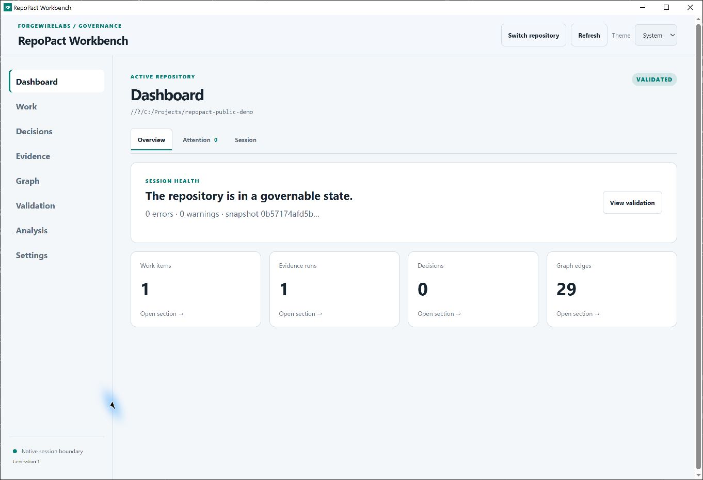
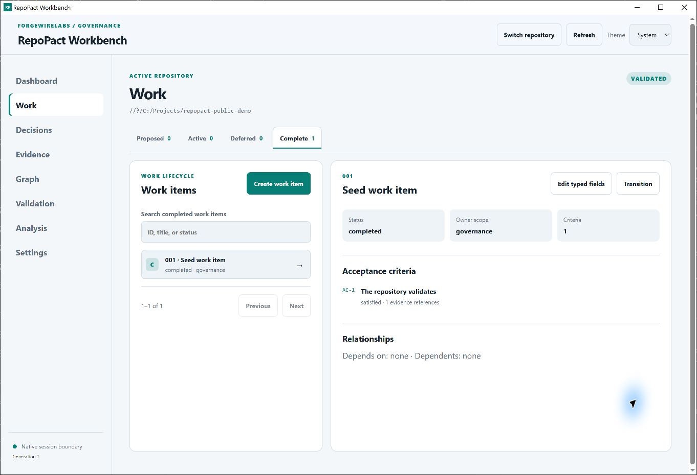
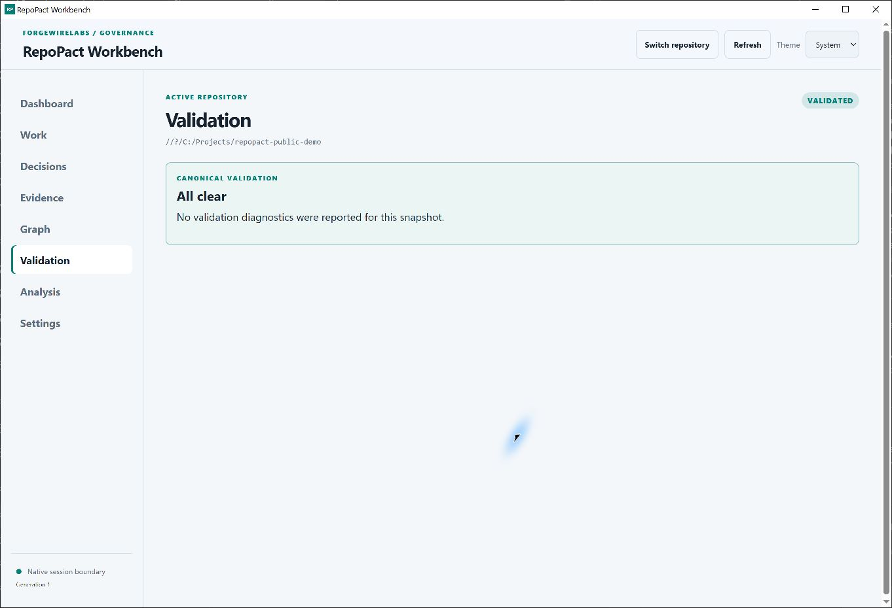
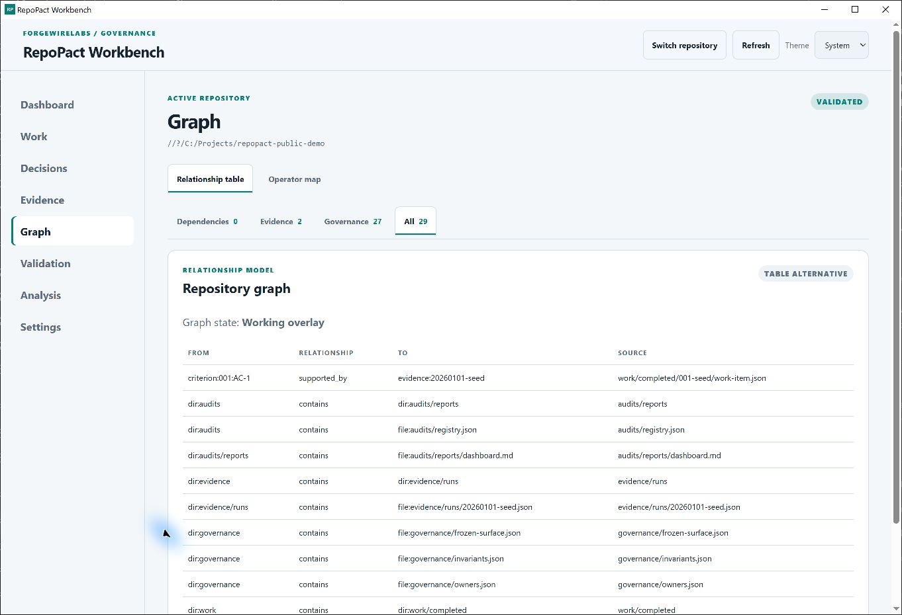
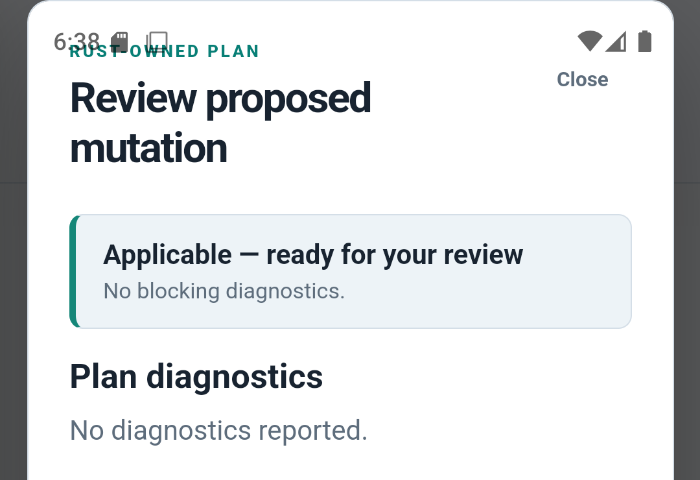

# RepoPact Workbench

**Explore a governed repository, understand what needs attention, and review supported changes in a native application.**

Workbench gives developers a visual way to inspect RepoPact work, decisions, evidence, validation, and repository relationships. It keeps the human review step visible when preparing supported changes.



*Windows x64 desktop capture from a local source build. The application is running against a disposable copy of the Core conformance fixture; no private repository, credentials, or session tokens are shown.*

[What you can do](#what-you-can-do) · [Workflow](#a-reviewable-workflow) · [Get started](#get-started) · [Core relationship](#workbench-and-core)

## What you can do

- Open a local repository and see its validation state, active work, decisions, evidence, and session details.
- Find work and inspect its source-backed record details and lifecycle.
- Review validation diagnostics and navigate graph relationships, dependencies, evidence, and governance links.
- Prepare supported work-item changes as typed Core plans, inspect the preview and diagnostics, then explicitly apply or discard.
- Revalidate after an applied plan and see whether the change left the repository in a valid state.
- On Android, import a repository into app-private storage and export through the system document picker.

Workbench's views help people navigate the repository. The versioned records remain authoritative.

## A reviewable workflow

**Open repository → Explore work → Inspect constraints → Prepare changes → Review plan → Apply → Validate**

1. **Open.** Select a local repository. Android also supports importing a workspace through the system document picker.
2. **Explore.** Use the dashboard and Work, Decisions, Evidence, Graph, Validation, and Analysis areas to orient yourself.
3. **Inspect.** Open records and diagnostics to follow their source paths, relationships, and Core guidance.
4. **Prepare.** For supported work-item operations, ask Core to create a typed mutation plan.
5. **Review.** Read the plan preview, applicability, and diagnostics. A plan with blocking diagnostics cannot be applied.
6. **Apply or discard.** Applying is an explicit action. Plans are opaque and session-bound at the native/Core boundary; stale plans are rejected.
7. **Validate.** A successful apply is followed by Core validation. The resulting records and evidence in the repository are the durable state.

**Inspect a work item and its evidence**



*Genuine Windows x64 capture from the disposable demonstration repository described above.*

### See the application

The desktop gallery uses genuine Windows x64 captures from the same local source build and disposable repository as the hero. The fixture was not changed to produce the images.

<details>
<summary>Open the desktop workflow gallery</summary>

**Check canonical validation**



**Explore repository relationships**



</details>

**Android plan review (secondary platform example)**



The Android plan-review image is a curated crop of recorded platform evidence. The [native acceptance record](evidence/WI074-RPS-011-native-platform-acceptance-2026-09-28.json) defines its exact test scope and platform limitations.

Capture provenance, file hashes, and documentation-check results are recorded in the [README evidence manifest](evidence/WI074-RPS-020-readme-evidence-2026-10-21.json).

## Get started

Workbench is available as a source-build preview. **No packaged installers are currently listed on [GitHub Releases](https://github.com/ForgeWireLabs/repopact-workbench/releases).**

Install Node.js with npm, Rust with Cargo, and the [Tauri 2 prerequisites](https://v2.tauri.app/start/prerequisites/) for your target platform. Python and pip are not required to run the Workbench application.

```bash
git clone https://github.com/ForgeWireLabs/repopact-workbench.git
cd repopact-workbench
npm ci
npm run tauri -- dev
```

Build a native desktop bundle for the current platform:

```bash
npm run tauri -- build
```

For Android development, install the Android SDK/NDK, JDK, and Rust Android targets required by Tauri, then use:

```bash
npm run tauri -- android dev
npm run tauri -- android build
```

For a headless command-line workflow or to initialize/adopt a repository, install [RepoPact Core](https://github.com/ForgeWireLabs/repopact-core) and follow its [adoption tutorial](https://github.com/ForgeWireLabs/repopact-core/blob/main/docs/adopt-repopact.md).

## Workbench and Core

Workbench is the native user interface and application layer. [RepoPact Core](https://github.com/ForgeWireLabs/repopact-core) is the semantic authority for schemas, governance interpretation, validation, graph and analysis semantics, and typed repository operations. Workbench must not create a competing interpretation of RepoPact records.

The products have independent version streams. The current Workbench application package identifies as **0.1.0** in `package.json`, `src-tauri/tauri.conf.json`, and `src-tauri/Cargo.toml`. Its eight Core Rust dependencies are pinned to the exact Core revision `1c1f32ae619e8135227acfa87393696ff608951c`, whose source declares Core **3.1.3**. Matching version numbers are not required: the immutable dependency revision is the compatibility boundary reviewed when Workbench updates its Core pin.

| Core provides | Workbench provides |
| --- | --- |
| Schemas and governance interpretation | Native interface and presentation |
| Canonical validation and diagnostics | Repository selection and session state |
| Graph and analysis semantics | Filesystem observation and navigation |
| Typed mutation planning and application | Human review for supported operations |
| CLI and headless use | Desktop and mobile application integration |

Local repository use does not require a GitHub account. Optional GitHub integration uses network access when invoked; credentials are kept in platform-managed storage. Hosted workflows and remote publication are separate from ordinary Workbench use.

## Platform availability and evidence

- **Windows x64 desktop:** native build, Rust workspace tests, frontend tests, TypeScript checks, production frontend build, and generated-type check passed on the recorded baseline. Existing GUI interaction evidence is linked from the native acceptance record. This README's desktop screenshot is a fresh local source-build capture and is for product illustration.
- **Android API 35 x86_64 emulator:** build and runtime scenarios covered repository import, navigation, validation, graph queries, disposable mutation review/apply, post-apply validation, and restart/resume. This does not establish behavior on every device or every permission path.
- **Linux:** WSL2 headless build and tests passed. Linux graphical runtime and bare-metal Linux runtime have not been demonstrated.
- **macOS and iOS:** untested; no support claim is made.

See the [native platform acceptance record](evidence/WI074-RPS-011-native-platform-acceptance-2026-09-28.json) for exact revisions, commands, result scope, and limitations. Source availability and successful local builds are not a promise of published binaries.

## Development and contribution

The repository contains the Tauri application, Rust workspace, frontend, generated API types, tests, and platform evidence. Useful local checks include:

```bash
cargo test --workspace --all-targets --locked
npm run typecheck
npm test -- --run
npm run build
npm run types:check
```

Read [CONTRIBUTING.md](https://github.com/ForgeWireLabs/repopact-core/blob/main/CONTRIBUTING.md) and the repository's [agent contract](AGENTS.md) before contributing. For feature-specific details, see the [documentation guides](docs/guides/), including [GitHub snapshot import](docs/guides/github-snapshot-import.md) and [GitHub App setup](docs/guides/github-app-setup.md). Report issues through [GitHub Issues](https://github.com/ForgeWireLabs/repopact-workbench/issues).

## Limitations and support

Workbench presents and orchestrates supported Core operations; it is not a general shell, issue tracker, hosted CI service, or operating-system sandbox. Owner scopes and review steps do not imply arbitrary process or filesystem confinement. Optional integrations and platform security claims are bounded by evidence for their specific provider and target.

## License

RepoPact Workbench is licensed under [Apache-2.0](LICENSE).
